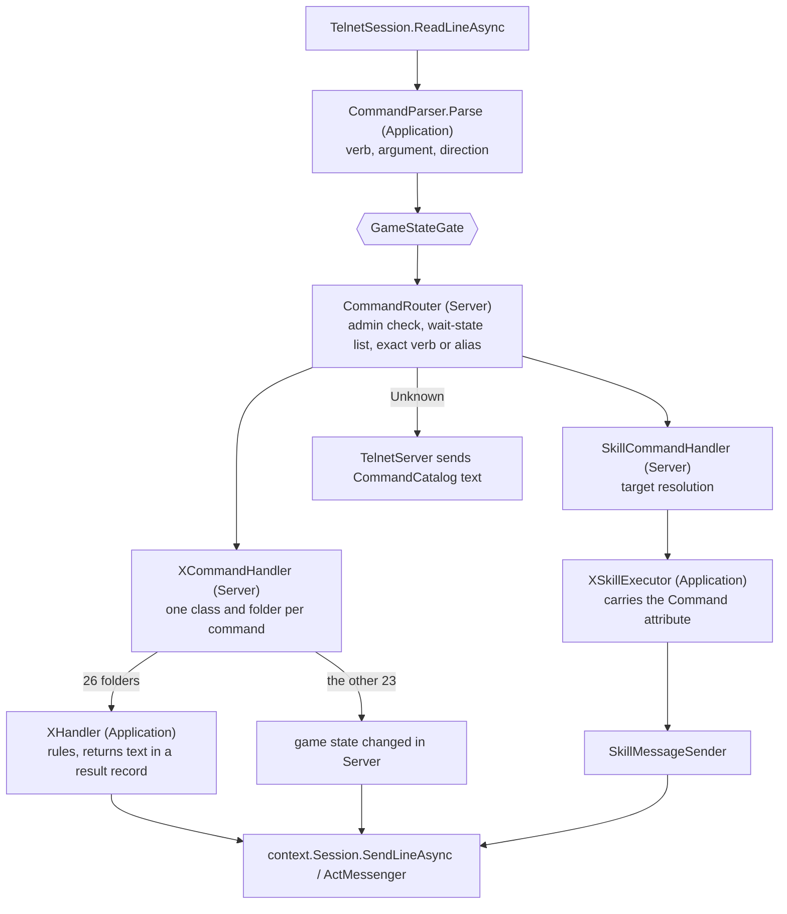
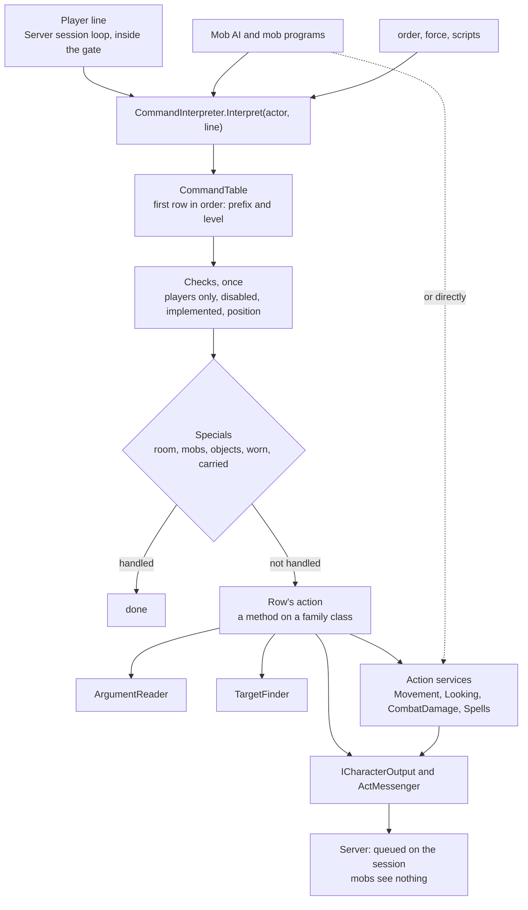
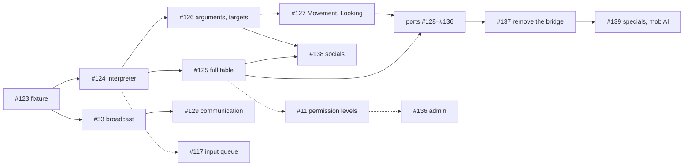

# Command architecture (#102)

Design, Nov 16, 2026. No code is changed by this document. It is the deep dive #102 asks for: where command handling
stands, the shape it should have to carry legacy's 513 commands, and the order to get there. It builds on finding F1
of the architecture review (#108), on #83 and on #117, and replaces none of them.

The six decisions in section 9 were agreed on Nov 16, 2026.

## 1. Summary

- **A command acts on a character, not on a connection.** The table, the interpreter and every command live in
  `EliteMud.Application`. The server's part shrinks to "read a line, hold the gate, call the interpreter".
- **One ordered table, in code, is the port of legacy `cmd_info`** (interpreter.c:116). One row per name: name,
  minimum position, minimum level, the action to run. All 513 legacy names are in it from the start; a row without
  an action is the backlog.
- **Table order is abbreviation priority**, as in legacy. Hand-listed aliases go.
- **A command is a method, not a class with a folder.** Commands are grouped in family classes that mirror the
  legacy source files (`act.movement.c` → `MovementCommands`). Only large commands get a class of their own.
- **Every check that isn't about one command is made once, in the interpreter**: level, position, players only,
  disabled, not implemented, specials. A command starts at its own first line of legacy code.
- **Commands are synchronous and speak through the output port** that already exists (`ICharacterOutput`,
  `ActMessenger`). No per-command adapter, no result records carrying finished text.
- **Shared parts are written once**: an argument reader, one target finder, action services (move, look) that
  commands, mob AI and scripts all call. A command never calls another command.
- **Socials are data** (`content/socials.json`) run by one action. Skills and spells are ordinary rows; how they
  are built inside is #71 and #31.
- **Adding a command is one method, one table row and its tests.** Section 6 is the recipe.

## 2. Today

### The flow



### What is spread where

| Concern | Where it is today |
|---|---|
| Splitting the line | `Application/Commands/Shared/CommandParser.cs`, which also turns directions into a `move` verb |
| Name and aliases | `[Command]` attributes: on 49 Server handlers and on 6 Application skill executors |
| Routing, admin, wait state | `Server/Adapters/Commands/Shared/CommandRouter.cs` |
| Position checks | Inside each command, each with its own wording (`LookCommandHandler.cs:33`, `MoveHandler.cs:27`, every skill's `CanUse`) |
| Rules | Application for 26 of the 49 command folders, Server alone for 23 (cast, the door commands, positions, recall, portal, wimpy, goto, `set*`) |
| Parsing arguments | Both layers for the same command (`get`: `all.x` in the adapter, the rest in `GetHandler`) |
| Finding targets | `TargetParser`, `DoorFinder`, `PortalFinder`, `SkillCommandHandler`, `CastCommandHandler`, and private `MatchesTarget` copies in `GetHandler`, `GetCommandHandler` and `LookCommandHandler` |
| Output | `context.Session.SendLineAsync`, `ActMessenger`, `SkillMessageSender`, result records with text |
| Unknown command | Router returns `Unknown`; `TelnetServer.cs:266` sends the text |
| Script hooks | Fired from three Server adapters (`move`, `say`, `look`) |

### What goes wrong because of it

- **Only a logged-in player can act.** `ICommandHandler.HandleAsync` takes a `ConnectionContext`, and
  `SkillContext.Actor` is a `PlayerState`. Mobs, `order`, `force` and scripts have no way in (#72, review F1).
- **Every command costs two classes and two folders**, and the split between them is different each time. The
  Server side is 4,927 lines for 54 commands; Application's `Commands` folder is another 3,793.
- **Names collide silently.** `bash` is declared twice (`BashCommandHandler.cs:15` for doors,
  `BashSkillExecutor.cs:15` for the skill). The router's dictionary keeps the last one registered, which by
  registration order is the door handler, so `bash <mob>` never reaches the skill. Legacy `do_bash`
  (act.offensive.c:484) handles both in one command.
- **The router knows too much and too little.** It reads `SkillCommandHandler`'s private `_executor` field by
  reflection to find a name (`CommandRouter.cs:38`), special-cases `NoOpCommandHandler` by type, and carries a
  hard-coded list of commands allowed while waiting (`:113`) that names `time`, `weather` and `help`, which don't
  exist.
- **No abbreviations.** Only exact names and listed aliases match. Several listed aliases differ from legacy:
  `f` is `flee` here and `finger` there, `ex` is `examine` here and `exits` there.
- **Commands call commands.** Eight files depend on `LookCommandHandler`; Application asks for a look through a
  marker (`SkillMessageTarget.VictimLooks`) that Server answers.
- **`async` is vestigial.** `TelnetSession.SendLineAsync` returns a completed task; `SkillCommandHandler.cs:229`
  already blocks on it with `.Wait()`.
- **Three ways to match a name**: substring of the name (skills), prefix of a keyword (get, look), and
  `TargetParser`. The same target can be found by one command and not by another.
- **The unknown-command text** is "Unknown command. Try look, who, say, zreset, north, go north."
  (`CommandCatalog.cs:5`), which advertises an admin command.
- **Dead code:** `PositionChangeCommandHandler` is referenced by nothing.

## 3. Legacy, and what to keep of it

`command_interpreter(ch, argument)` (interpreter.c:870) is the one entry point for everyone: players
(comm.c:450), mobs (mobact.c:94), mob programs (pfunctions.c:33), `order` (act.offensive.c:354) and `force`.

The table (interpreter.c:116–636) has 513 rows and five columns: name, minimum position, function, minimum
level, subcommand.

| | Count |
|---|---|
| Rows | 513 |
| Distinct functions | 194 |
| Socials (`do_action`) | 238 |
| Rows with a subcommand (`SCMD_*`) | 69 |
| Immortal rows (`LEVEL_DEITY`) | 90 |
| `do_not_here` rows (buy, sell, list, rent, ...) that only a special procedure answers | 15 |

So 513 names are about 190 pieces of behaviour, and nearly half of the names are data. The design below keeps
that ratio.

What the interpreter does, in order, for every command:

1. The actor stops hiding.
2. Alias expansion, speedwalk, a leading repeat count, and `;` to chain commands (players only).
3. A first character that isn't a letter is a command by itself, so `'hi` is `say hi`.
4. Lookup: the first row, in table order, whose name starts with the typed word and whose level the actor has. Rows
   above the actor's level are skipped, not refused.
5. No row: one of six "huh?!?" replies. Then: disabled (`check_disabled`), frozen, no function ("Sorry, that
   command hasn't been implemented yet."), position below the row's minimum (one line per position), berserk,
   exhausted.
6. Logging, then the immortal power check (`immortal_interpreter`, act.wizard.c:5253: `IMM_*` flags per command).
7. `special(ch, cmd, line)` (interpreter.c:1172): special procedures on the room, the mobs in it, the objects in
   it, the actor's equipment and inventory get the command first. This is how shops, guildmasters, boards and
   banks work.
8. The command's function.

Keep: the single entry point, the table and its order, checks made once, subcommands, specials before the
command. Drop: command numbers (`CMD_IS`, specials comparing `cmd`), global buffers, and position lines that
differ per command for no reason.

## 4. Target design

### 4.1 Who owns what

| Layer | Owns | Does not |
|---|---|---|
| **Game** | Rules and data with no I/O: `Position`, formulas, character and object state | Know commands exist |
| **Application** | The table, the interpreter, every command, the argument reader, the target finder, action services, the ports (`ICharacterOutput`, and the few in 4.12) | Know about Telnet, sessions, the gate or the database |
| **Server** | Telnet, the session loop, the gate, the implementations of the ports | Contain a single command |
| **Content** | Socials, spells, skills, help text | Contain the table |
| **Scripting** | Running Lua for a special or an event | Decide when |

### 4.2 The flow



### 4.3 The table

One file, `Application/Commands/CommandTable.cs`, in legacy order. It is the composition root for commands and the
only place a name is bound to behaviour.

```csharp
public delegate void CommandAction(CommandContext context);

public sealed record CommandEntry(
    string Name,              // what is typed; matched by prefix, in table order
    Position MinPosition,
    int MinLevel,             // 0, 1 or Levels.Deity; immortal powers come with #11
    CommandAction? Run,       // null: legacy has it, we don't yet
    CommandFlags Flags = CommandFlags.None);

[Flags]
public enum CommandFlags
{
    None = 0,
    PlayersOnly = 1,          // legacy "if (IS_NPC(ch)) return;"
    Addition = 2              // not a legacy row (setlevel, search, ...)
}
```

```csharp
// Legacy cmd_info (interpreter.c:116). Order is abbreviation priority: never sort, never group.
Add("north",   Position.Standing, 0, movement.Go(Direction.North));
// ...
Add("say",     Position.Resting,  0, communication.Say);
Add("'",       Position.Resting,  0, communication.Say);
Add("qui",     Position.Dead,     0, other.QuitTypedShort);        // "You have to type quit - no less"
Add("quit",    Position.Dead,     0, other.Quit, PlayersOnly);
Add("kill",    Position.Fighting, 0, combat.Kill);
Add("goto",    Position.Sleeping, Levels.Deity, admin.Goto);
Add("give",    Position.Resting,  0, null);                        // do_give, act.obj1.c
Add("drink",   Position.Resting,  0, items.Drink(DrinkMode.Drink));
Add("sip",     Position.Resting,  0, items.Drink(DrinkMode.Sip));
Add("buy",     Position.Standing, 0, other.NotHere);               // a shop's special answers first
// ...
AddSocials(socials);                                               // legacy's last block, in file order
```

Why code and not attributes or content:

- **Attributes** (today) have no order, tie one name to one class, and scatter 500 rows over as many files. A
  collision or a wrong position is invisible until someone types it.
- **Content** (`commands.json`) would bind rows to code by string, so a typo is a startup error instead of a
  compile error, and it buys nothing: a command needs code anyway. What is worth changing at runtime is "disabled",
  and that is a set of names, not the table.
- **One code table** is checked by the compiler, reads like the legacy table next to it, and a diff shows exactly
  which commands a PR adds. Each PR touches its own rows, so conflicts are rare and trivial.

The first version of the file is generated once from `interpreter.c` with every action `null`, then the 54
commands that exist are bound. Legacy is frozen, so the generator is a throwaway script, not a tool to maintain.

Rows that legacy doesn't have (`setlevel`, `setskill`, `setspell`, `search`, `affects`, `shout`) are marked
`Addition` and need a deliberate place in the order, since their position decides what they
shadow. Five legacy rows sit inside the socials block without being socials (`catnap`, `flip`, `insult`, `pose`,
`worship`); they are code rows placed among the socials by the name they precede.

Startup checks, each a fail-fast with a clear message: no duplicate names; every social in the table has messages
and every social in content has a row; no `Addition` without a position in the order.

### 4.4 A command

```csharp
public sealed class CommandContext
{
    public ICombatant Actor { get; }        // "Character" once #81 lands
    public PlayerState? Player { get; }     // the actor as a player; null for a mob
    public CommandEntry Entry { get; }      // the row that matched
    public string Argument { get; }         // the rest of the line, trimmed
    public ArgumentReader Args { get; }     // see 4.6
    public void Reply(string line);         // to the actor only (legacy send_to_char)
}
```

```csharp
/// <summary>Standing, sitting, resting, sleeping and waking (legacy act.movement.c).</summary>
public sealed class PositionCommands(ActMessenger act)
{
    // Legacy do_stand, act.movement.c:952
    public void Stand(CommandContext c)
    {
        switch (c.Actor.Position)
        {
            case Position.Standing:
                c.Reply("You are already standing.");
                break;
            case Position.Sitting:
                c.Actor.Position = Position.Standing;
                c.Reply("You stand up.");
                act.ToNotChar(c.Actor, "$n clambers to $s feet.");
                break;
            // ...
        }
    }

    // "sleep" and "catnap" are two rows on one method
    public CommandAction Sleep(SleepMode mode) => c => { /* ... */ };
}
```

- **Synchronous, returns nothing**, like legacy `ACMD`. Output only queues, so there is nothing to await, and a
  command that can't `await` can't do database work inside the gate. Nothing consumes a result; what a command did
  is visible in the world and in what was sent.
- **Dependencies come through the family's constructor** (dependency injection, as today). The context carries
  only what belongs to this one invocation.
- **A family is a legacy source file**: movement, communication, informative, items, combat, other, socials, admin.
  Looking up where `do_x` went is then a matter of knowing which `act.*.c` it was in.
- **A command gets its own class** in the family's folder when it passes roughly 150 lines or has helpers nobody
  else uses (`look`, `get`, `put`, `cast`, `wear`). It is still bound by one table row.
- **Every command names its legacy source** in a comment (`// Legacy do_give, act.obj1.c:1047`), and notes any
  deliberate difference where it is made.

### 4.5 The interpreter

`CommandInterpreter.Interpret(ICombatant actor, string line)`, one class, the steps of section 3 as private
methods in the same order. Not a plug-in pipeline: the order is a rule of the game, and one readable method is
worth more than configurability nobody needs. Specials (4.10) are the one extension point.

- Unknown, refused and not-yet-implemented replies are sent by the interpreter, so they read the same for a
  player, an ordered mob and a forced player.
- The seven position lines ("In your dreams, or what?", "Maybe you should get on your feet first?", ...) are
  written once. Commands lose their own position checks unless legacy has an extra one inside the function.
- Aliases, speedwalk, repeat counts and `;` are steps of their own in front of the lookup; each is a later card
  and has its place reserved.
- **Wait state is not the interpreter's business.** With #117 the loop takes a player's next line only when their
  wait has run out; until then today's refusal stays in the Server where it is.

The Server's whole part, when the migration is done:

```csharp
var line = await context.Session.ReadLineAsync(cancellationToken);
using (await _gate.EnterAsync(cancellationToken))
{
    _interpreter.Interpret(context.Player, line);
}
```

### 4.6 Arguments and targets

Two shared pieces, used by every command, skill, spell and social. Nothing else splits a line or matches a name.

- **`ArgumentReader`**: the legacy helpers over the argument string: next word, skipping fill words (`in`,
  `from`, `with`, `the`, `on`, `at`, `to`) as `one_argument` does; next word as typed (`any_one_arg`); two words;
  first word and the rest (`half_chop`); a quoted name (`cast 'magic missile' guard`).
- **`TargetFinder`**: legacy `generic_find` and its family in handler.c. One name rule (`isname`,
  handler.c:69), `2.sword`, `all` and `all.sword` (`FIND_INDIV` / `FIND_ALL` / `FIND_ALLDOT`), a search scope
  (`FIND_CHAR_ROOM`, `FIND_CHAR_WORLD`, `FIND_OBJ_INV`, `FIND_OBJ_ROOM`, `FIND_OBJ_EQUIP`), and visibility in one
  place when it arrives. Skills and spells add their rule on top (`TAR_FIGHT_VICT`, `TAR_SELF_ONLY`, ...; spells.h
  :318).

`TargetParser` is the start of this and moves into it. `DoorFinder` and `PortalFinder` become scopes of it. The
substring match in `SkillCommandHandler` and the `MatchesTarget` copies go. Where a command's matching changes as
a result, the PR says so.

### 4.7 Output

Commands write through what exists: `CommandContext.Reply` for the actor, `ActMessenger` for anything with
`$n`/`$N`/`$p`, and after #53 one broadcast call on `ActMessenger` with an audience (room, zone, everyone) and a
filter (asleep, channel off, ignoring).

This goes one step further than #83: output is a port since #79, so there is no adapter left to hand a result to.
Result records stay only where one calculation has several callers that word it differently, which today means
`DamageOutcome` and its `SkillMessage`s.

The prompt is not a command's concern: the session writes it after a command's output, as legacy `make_prompt`.

### 4.8 Actions shared by commands, mobs and scripts

Whatever more than one caller needs is an action service in Application, taking a character:

| Service | Callers |
|---|---|
| `Movement.Move(actor, direction)` and `Movement.Transfer(actor, room)` | direction commands, flee, recall, goto, portals, mob wander and track, followers, death |
| `Looking.ShowRoom(viewer)`, `Looking.LookAt(viewer, target)` | `look`, arriving anywhere, fleeing, `examine`, `scout` |
| `CombatDamage.Apply` (exists) | every source of damage |
| `Spells.Cast(caster, spell, target)` | `cast`, scrolls, wands, potions, mobs |

`Movement` is where leave and arrive messages (#116) and the room's enter event belong, so they happen on every
way in, not only when a player types a direction.

**Rule: a command never calls another command's method.** If two commands share behaviour, it moves into a
service. The exception is the one legacy has: `order`, `force`, mob programs and scripts call
`Interpret(target, text)`, because "as if they had typed it" is the behaviour.

### 4.9 One action, several names

Legacy's subcommand becomes a typed argument fixed in the row, so no command inspects the name it was called by:

| Legacy | Here |
|---|---|
| Six `do_move` rows | `movement.Go(Direction.North)` ... |
| `do_gen_com` × 9 (gossip, auction, grat, pksay, ...) | `communication.Channel(Channels.Gossip)` |
| `do_gen_tog` × 7 (brief, ...) | `other.Toggle(Preference.Brief)` |
| `do_gen_ps` × 15 (news, info, credits, wizlist, ...) | `informative.ShowText("news")` |
| `do_not_here` × 15 | `other.NotHere` |
| `do_drink` / `sip`, `do_eat` / `taste` | `items.Drink(DrinkMode.Sip)` |

The first five lines are 52 rows on five actions.

### 4.10 Socials, skills and spells

- **Socials.** `content/socials.json`, imported once from `lib/misc/socials` (2,070 lines; the importer logs every
  entry it skips or repairs, as for other legacy content). Each social carries its name, minimum position and
  level (from `cmd_info`), the hide flag and minimum victim position (from the socials file), and its message set.
  One `SocialCommand` runs them all through `TargetFinder` and `ActMessenger`. The `{a^b^c}` random-choice syntax
  in the messages is expanded by the social action. Schema goes in `docs/content-schema.md`.
- **Skills** are ordinary rows (`kick`, `bash`, `backstab`, ...), with the row's position and level from legacy.
  `bash` becomes one command that looks for a character in the room, then for a door, as `do_bash` does. Skill code takes a
  character instead of a `PlayerState`, and its targeting moves to `TargetFinder`. Whether a skill is a class, two
  classes or data is #71; the table doesn't care.
- **Spells** stay behind one `cast` row. Spell lookup, the `TAR_*` rule and minimum position come from spell
  data; `CastCommandHandler`'s 482 lines split into the `cast` command (parse, find spell), `TargetFinder`, and
  `Spells.Cast`. How spell effects are composed is #31.

### 4.11 Specials and scripts

`ISpecialProcedures.TryHandle(CommandContext)` is asked before the row's action, in legacy order: the room, the
mobs in it, the objects in it, what the actor wears, what the actor carries. Returning true means handled.

- A special is attached to a room, mob or object in content by name (`"special": "shopkeeper"`), and is either a
  C# class (shop, guildmaster, bank, board, postmaster) or a Lua script.
- Specials match on the row (`c.Entry.Name == "buy"`), never on a number.
- **Scripts hook in two ways only:** as a special, deciding whether to handle a command; and as a listener to an
  event raised by an action service (entered a room, spoke, died). Today's `OnEnterRoom`, `OnSay` and `OnLook`
  become events raised by `Movement`, `say` and `Looking`, so they fire for mobs and forced moves too.
  The script API and its sandbox are review F7 and #112, not this document.

### 4.12 What only the Server can do

Three commands touch things Application must not know. Each goes through a small port, implemented in Server:

| Need | Port | Notes |
|---|---|---|
| May this actor use this row? | `ICommandAccess` | Today `AdminPolicy` by account name. #11 replaces it with level and immortal powers on the character, and the port goes. |
| `quit` | `ISessionControl.Disconnect(player)` | Becomes part of the review's `PlayerSessions` (F2.4). |
| `save` | The character store of #118 | Until then the Server keeps this one row. |

### 4.13 Layout

```
src/EliteMud.Application/Commands/
  CommandTable.cs  CommandEntry.cs  CommandContext.cs  CommandInterpreter.cs
  ArgumentReader.cs
  Targeting/        TargetFinder.cs, scopes, target rules
  Movement/         MovementCommands.cs, DoorCommands.cs, PositionCommands.cs   (act.movement.c)
  Communication/    CommunicationCommands.cs, channels                           (act.comm.c)
  Informative/      InformativeCommands.cs, LookCommand.cs, ScoreCommand.cs      (act.informative.c)
  Items/            ItemCommands.cs, GetCommand.cs, PutCommand.cs, WearCommand.cs (act.obj1.c, act.obj2.c)
  Combat/           CombatCommands.cs                                            (act.offensive.c)
  Other/            OtherCommands.cs                                             (act.other.c)
  Socials/          SocialCommand.cs, SocialCatalog.cs                           (act.social.c)
  Admin/            AdminCommands.cs                                             (act.wizard.c)
src/EliteMud.Application/Actions/   Movement.cs, Looking.cs
tests/EliteMud.Tests/Commands/      one test class per family or large command, plus CommandTableTests
```

`Server/Adapters/Commands` and its 50 folders are gone at the end, with `CommandRouter`, `ICommandHandler`,
`CommandOutcome`, `CommandAttribute`, `CommandParser`, `CommandCatalog` and `CommandResults.cs`.

## 5. Tests

- **One way to test a command: type it.** A `GameFixture` in the test project builds a small world, adds players
  and mobs, and records output per character through a recording `ICharacterOutput`:

  ```csharp
  var game = new GameFixture().WithRoom(Square);
  var bob = game.Player("Bob", Square);
  var ann = game.Player("Ann", Square);

  bob.Sits();
  game.Type(bob, "st");                 // through the interpreter: abbreviation, position, the command

  Assert.Equal(["You stand up."], game.Seen(bob));
  Assert.Equal(["Bob clambers to his feet."], game.Seen(ann));
  ```

  No Telnet, no connection, no `await`. The same test covers the row, the checks and the command, and it doesn't
  change when a command's internals do. This fixture is written first (step 0) against today's router, so the
  existing behaviour is pinned before anything moves.
- **`CommandTableTests`**, which keep 500 rows honest:
  - the table's names, in order, equal legacy's 513 (a fixture file generated once from `interpreter.c`), plus
    the rows marked `Addition`;
  - each row's position and level equal legacy's, except those listed in a deviations file with a reason;
  - a set of abbreviations players rely on resolve as legacy: `l`, `k`, `n`, `s`, `i`, `sc`, `eq`, `c`, `o`, `g`.
- **Interpreter tests**, one per check: each position line, rows above your level are skipped rather than
  refused, not implemented, players only, a special handling the command first.
- **Progress** is a count the table gives for free: rows with an action out of 513. Print it in the test output
  and keep the number in `docs/roadmap.md`.

Commands that roll dice need a seedable source to be testable this way; today `Random` is used directly in 18
places. That is review F5's subject; new commands should take the dice from wherever that lands rather than
add a nineteenth.

## 6. Adding a command

1. Find it: `cd ~/Dev/elitemud-index && cscope -d -L -1 do_give`. Read the function and what it calls.
2. Write the tests first, through `game.Type(...)`: the success path with what each onlooker sees, and each
   refusal with legacy's wording.
3. Write the method on the family class for its legacy file, with the `// Legacy do_give, act.obj1.c:1047`
   comment. Use `c.Args`, `TargetFinder`, an action service, `c.Reply` and `ActMessenger`. If it needs something another
   command already does, move that into a service first, as its own commit.
4. Bind the row in `CommandTable.cs`: replace `null` with the method. Don't touch position, level or order.
5. If it differs from legacy on purpose, say where and why in the code and in the PR.

Rules that keep the five-hundredth command as cheap as the fifth:

- No position, level, admin or "players only" checks inside a command; they are the row's.
- No line splitting or name matching inside a command; `ArgumentReader` and `TargetFinder` only.
- No command calls another command; no command knows the name it was called by.
- No `PlayerState`-only parameter unless the row is `PlayersOnly`.
- No `async`, no session, no database, no `Console.WriteLine`.
- One PR per command or per small group from the same legacy function family; never a command plus a refactor.
- If a third copy of anything appears, stop and extract it before adding the command.

## 7. Migration

Each step is one PR unless noted, leaves the tests green, and changes behaviour only where it says so. The
numbering maps to track B of the review's sequence.

| # | Step | Behaviour change | Size |
|---|---|---|---|
| 0 | `GameFixture` with `Type` and `Seen`, on today's router. Move the existing command tests onto it; add tests for commands that have none. | None | M |
| 1 | `CommandEntry`, `CommandTable`, `CommandContext`, `CommandInterpreter` in Application, with rows for the 54 existing commands only. The interpreter does lookup and checks; for a row not yet ported it returns "unported" and the Server router runs the old handler. Admin goes through `ICommandAccess`. `[Command]` attributes, the private-field reflection and the `NoOp` handler go. | Only the `bash` collision is resolved (a character, then a door) | M |
| 2 | The full legacy table: all 513 names in order, unbound rows answer "not implemented yet", position and level per row, legacy's unknown and position lines. Prefix matching replaces aliases. `CommandTableTests`. | **Yes**, see section 8 | M |
| 3 | `ArgumentReader` and `TargetFinder`; one broadcast on `ActMessenger` (#53). No command uses them yet except through `TargetParser`'s existing callers. | None | M |
| 4 | `Movement` and `Looking` services. `look` becomes the first ported command; `VictimLooks` and the eight `LookCommandHandler` dependencies go. | Leave and arrive messages appear (#116) | M |
| 5 | Port by family, one PR each, deleting each adapter and its Application `XHandler` as it goes: positions (#101), communication, informative, items (#83), doors and portals, combat and skills, `cast`, other, admin. | Position lines become legacy's; matching follows `TargetFinder` | 9 × S–M |
| 6 | Delete the bridge: `CommandRouter`, `ICommandHandler`, `Server/Adapters/Commands`. `quit` and `save` through their ports. | None | S |
| 7 | Socials: import, `content/socials.json`, `SocialCommand`. | 238 new commands | M |
| 8 | Specials and events; `order` and `force`; mob AI acts through `Interpret` and the action services (#72). | New behaviour | L, its own design |

After step 2, new commands can be added the new way while old ones are still being ported, so steps 5 and 7 and
new-command work can overlap. The input queue (#117, #119 step 4) needs step 1 and nothing later.

Child cards: step 0 is #123, step 1 #124, step 2 #125, step 3 #126 (with #53) and step 4 #127. Step 5 is nine
cards: positions #128, communication #129, informative #130, items #131, doors and portals #132, combat and skills
#133, cast #134, directions and the rest #135, admin #136. Step 6 is #137, step 7 #138 and step 8 #139.

### 7.1 Order of the cards

What each card needs first. An arrow means "must be merged before".



One card at a time, in this order. Nearly every card adds or changes rows in `CommandTable.cs`, so two of them
in flight at once means rebasing one on the other for no gain.

| # | Card | Why here |
|---|---|---|
| 1 | #123 Fixture | Pins today's behaviour. Every later card is checked against these tests. |
| 2 | #124 Interpreter and table | Everything else needs it. The riskiest card: keep it free of behaviour changes apart from `bash`. |
| 3 | #53 One broadcast | Small and independent, and safe once #123 covers the channels. Out of the way before communication is ported. |
| 4 | #125 Full table, abbreviations | The change players notice, so make it early: every port after it is tested against the final matching rules, not twice. |
| | **Checkpoint: play on a live server.** | Walk through section 8's table by hand. Fix what feels wrong before 12 more cards build on it. |
| 5 | #126 Argument reader, target finder | The last shared part a port needs. |
| 6 | #127 `Movement`, `Looking`, `look` | Removes the eight dependencies on `LookCommandHandler` that would otherwise tie the ports together. Closes #116. |
| 7 | #128 Positions (with #101) | The smallest family: five commands, no targets, no arguments. Use it to settle what a ported family looks like, and adjust section 6's recipe if it doesn't fit. |
| 8 | #138 Socials | 238 commands for one action, and the first heavy use of `TargetFinder` on characters. Needs nothing from the later ports, and shows the table carrying real volume. |
| 9 | #135 Directions, recall, wimpy, search | Small, and puts `Movement` from #127 to use straight away. |
| 10 | #129 Communication | Channels as one action with an argument; #53 is already in. |
| 11 | #130 Informative | Many commands, all read-only, so little can go wrong. |
| 12 | #132 Doors and portals | First family that lives in Server only (about 740 lines) and the first use of the door scope in `TargetFinder`. |
| 13 | #131 Items (closes #83) | The hardest matching: `all`, `all.x`, `2.x`, containers. By now `TargetFinder` has been through four families. |
| 14 | #133 Combat and skills | Changes `SkillContext` to take a character and moves `SkillMessageSender`. `bash`'s door half reuses what #132 settled. |
| 15 | #134 Cast | Shares the target rule (`TAR_*`) that #133 puts on `TargetFinder`. |
| 16 | #136 Admin | Six commands with no player impact. If #11 is done by now its rows get real levels; if not, it ports on `ICommandAccess` and #11 follows. |
| 17 | #137 Remove the bridge | Only possible when all nine ports are in. |
| 18 | #139 Design: specials, `order`, mob AI | The design can be written any time after #127; building it needs #137. |

Cards outside this list that hang on it:

- **#117 (input queue)** can start after #124, but it also needs the pulse loop of #119. It belongs to that track.
- **#11 (permission levels)** can start after #125. Best before #136, not required.
- **#71 and #31 (how skills and spells are built)** come after #133 and #134. Until then, no new skill or spell is
  ported in the two-class style.
- **New commands** (`give`, `exits`, `finger`, ...) can be added by the recipe in section 6 any time after #126.
  Prefer the ones section 8 lists as "not implemented yet" behind a common abbreviation: `give` (`g`), `exits`
  (`ex`), `finger` (`f`), `fly` (`fl`).

If a second session works in parallel, the cards that don't collide with the main line are #53 (alongside #124),
#138 (alongside any port) and the #139 design.

## 8. What players will notice

Step 2 is the visible one. All of it is legacy parity, and the PR should list it:

| Typed | Today | After |
|---|---|---|
| `f`, `fl` | flee, unknown | finger and fly (neither implemented yet); `fle` is flee |
| `ex` | examine | exits (not implemented yet); `exa` is examine |
| `st`, `stat` | stat | the same command under its legacy name, `stats` |
| `bs` | backstab | unknown; `ba` is backstab |
| `me <text>` | emote | unknown; legacy has `emote` and `:` |
| `go north` | moves north | gossips "north": legacy has no `go`, and it is a prefix of `gossip` |
| `reset` (admin) | zreset | unknown; `zr` is zreset |
| `shout`, `affects`, `search` | work | work, as `Addition` rows; legacy has `yell` |
| `g`, `gi` | unknown | give (not implemented yet) |
| Any prefix (`inv`, `sco`, `equ`, `wie`) | mostly unknown | works |
| Unknown command | "Unknown command. Try look, who, ..." | "huh?!?" and its five variants |
| Wrong position | a different line per command | legacy's line per position |
| A legacy command not yet ported | unknown | "Sorry, that command hasn't been implemented yet." |

Anyone who misses `f` for flee can have it back with the `alias` command once that exists, which is how legacy
players did it.

## 9. Decisions (agreed Nov 16, 2026)

1. **The table is one C# file in legacy order**, not attributes and not content. (Recommended; reasons in 4.3.)
2. **All 513 legacy names go in at step 2**, with unbound rows answering "not implemented yet". The alternative is
   to add rows as commands are written, which keeps unfinished names hidden but makes abbreviations shift every
   time a command lands. (Recommended: all at once.)
3. **Legacy abbreviations replace today's aliases**, including the losses in section 8. (Recommended; the
   alternative is a short list of kept aliases as `Addition` rows, which is cheap but is a permanent difference
   from legacy.)
4. **Commands are methods on family classes** mirroring the legacy files, with a class only for large ones.
   (Recommended; the alternative, one class per command in family folders, costs about 190 files for no gain.)
5. **Commands return nothing and send their own output**, going past #83's "return an outcome, adapter
   displays". #83 would then close with step 5's items PR.
6. **Step order**: fixture, interpreter, full table, shared parts, then families. In particular that step 2's
   visible change comes before the ports, so every port is checked against the final rules.

## 10. #102's open questions, answered

| Question | Answer |
|---|---|
| Where does the table live? | In code, one file in Application (4.3). Socials' rows come from content. |
| How does abbreviation priority work? | Table order, first prefix match the actor has the level for; rows above the actor's level are skipped (3, 4.5). |
| How do mobs use skills and spells? | The same row and the same service, called with a character: `Interpret(mob, "kick bob")` or `Spells.Cast(mob, ...)` (4.8). It is a requirement of every step, not a later feature. |
| How do scripts hook in? | As specials before a command, and as listeners on events from action services (4.11). |
| How is content versioned? | `socials.json` carries a `version` like the other content files and is described in `docs/content-schema.md`. The table is code and is versioned by git. |

## 11. Not covered here

- How a skill or a spell is built inside: #71, #31, #59.
- `Character` as the shared type for players and mobs: #81. This design uses `ICombatant` until then and loses
  nothing by it.
- Permission levels and immortal powers: #11. The row already has the level; the powers table
  (`immcmd_info`, act.wizard.c:5156) is that card's.
- The input queue and wait state: #117. The pulse loop: #119.
- Sessions, takeover and saving: review F2, #118.
- Aliases, speedwalk, repeat counts and `;`: each a small card after step 2.
- The script API and sandbox: review F7, #112.
