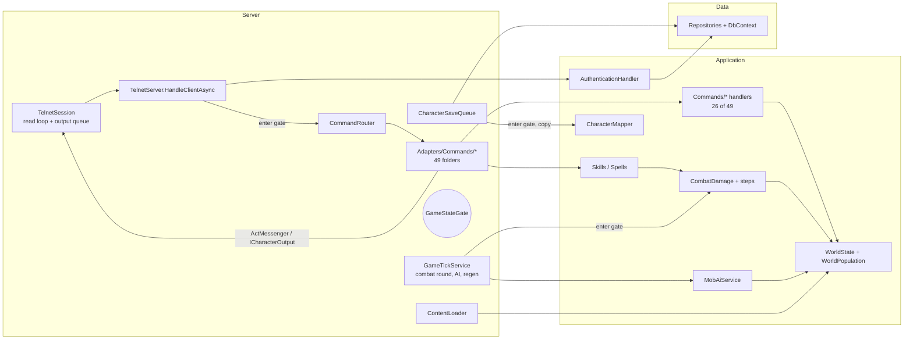

# Architecture review, Nov 15, 2026

Reviewed at commit `1ba6055` (main). Evaluation only: no code was changed. Every claim below was read in the
code; the ones marked **reproduced** were also run against a throwaway server or the test suite.

## 1. Summary

- **Shape:** a layered game (Game → Application → Server) with one gate serialising state changes. The domain core
  is healthy: one damage path, one owner of who-is-where (`WorldPopulation`), one stat resolver, fail-fast formulas.
- **Main weakness:** the game is driven from the Server project. Commands run against a Telnet connection
  (23 of 49 command folders have all their logic in Server), and the whole tick, including the combat round, lives
  in `Server/GameTickService`. Only a logged-in player can *do* anything, so mobs, scripts, `order` and `force`
  each need a second implementation.
- **Strengths:** `CombatDamage` and its steps, `WorldPopulation`, `EffectiveStats`, `GameStateGate` with queued
  output, formula checking at startup, the content validator, and a large legacy-referenced test suite.
- **State today:** build clean (0 errors, 17 warnings). Tests: 694 pass, 1 fails on every run of a clean checkout
  (`LegacyImporterTests.ImportAsync_WritesObjectData`; it only passes where a stale build folder exists, see F5).
- **Three changes to make first:**
  1. Fix sessions and saving: one live character per login, stable identity (#66), a database scope per login.
     Three bugs here are reproduced (F2).
  2. Move command routing and actions into Application, acting on a character instead of a connection (F1).
  3. Move the tick into Application on a pulse clock, which also gives zone resets, decay and mob affects a home (F3).

## 2. Current architecture

| Project | Lines | Owns | References |
|---|---|---|---|
| `EliteMud.Game` | 2,835 | Definitions (records), `PlayerState`, `ObjectInstance`, `CombatCalculator`, enums | none |
| `EliteMud.Application` | 13,201 | Combat, skills, spells, AI, progression, `WorldState`, `MobInstance`, login flow, some commands | Game, **Data**, Scripting |
| `EliteMud.Server` | 8,745 | Telnet, gate, tick, save queue, content loading, bootstrap, **60 command adapter files (4,927 lines)** | Application, Game, Data, Scripting |
| `EliteMud.Data` | 451 + migrations | EF Core entities, two repositories | Game |
| `EliteMud.Scripting` | 550 | Lua formulas and room scripts | Game |
| `EliteMud.Legacy` | 3,043 | Legacy world and rules importer | Game |
| `EliteMud.Cli` | 491 | Import and zone grouping | Legacy, Game |
| `tests/EliteMud.Tests` | 14,562 | 695 tests | Game, Legacy, Application, Server, Data |



**A command, end to end.** `TelnetServer.HandleClientAsync` reads a line, `CommandParser` splits verb and argument,
the session takes `GameStateGate` and calls `CommandRouter.HandleAsync(command, ConnectionContext)`. The router
checks admin rights and wait state, then calls an `ICommandHandler` in `Server/Adapters/Commands`. That adapter
either holds the rules itself or calls an Application handler and turns its result into act messages. Output goes
through `ActMessenger` → `ICharacterOutput` → `TelnetSession.SendLine`, which only queues, so the gate is released
without waiting on the network. Persistence is separate: quit, `save`, the 5-minute auto-save and
`PlayerState.SaveRequested` push a request onto `CharacterSaveQueue`; its worker loads the row, takes the gate to
copy the live `PlayerState` onto the entity, and writes outside the gate.

## 3. Findings

Ranked by value to the roadmap. Cost is S (one PR, a day or two), M (3–6 PRs), L (a series over weeks).

### F1. Commands act on a connection, not on a character

**Problem.** The unit of action is "a Telnet connection typed a verb", so nothing but a logged-in player can act.

- `ICommandHandler.HandleAsync(CommandRequest, ConnectionContext, …)` lives in Server
  (`Adapters/Commands/Shared/ICommandHandler.cs:9`). The router, the wait-state rule and the admin check are in
  Server too (`CommandRouter.cs:89`, `:110`).
- 23 of 49 command folders have no handler in `Application/Commands`: cast (482 lines), the five door commands
  (open/close/lock/unlock/bash, 906 lines), the five position commands, recall, portal, wimpy, quit, save, goto and
  the `set*` commands. They change game state directly in Server; for example `CastCommandHandler.cs:118` spends
  mana and `:124` sets the wait state.
- Skills take `SkillContext(PlayerState Actor, …)` (`ISkillExecutor.cs:126`), so a mob can't use one (#72).
- Mob AI can't use the shared paths either. It starts fights by writing fields
  (`MobAiService.cs:424`, `:478`), skipping `CombatCalculator.SetFighting` and the damage path, and
  it carries six `TODO: Send act()` comments (`:215`, `:249`, `:333`, `:334`, `:434`, `:476`) because it has no
  way to speak. Its Lua hook is a stub that returns false (`:171–178`).
- Moving a character is done in 8 places (`Population.Move` in `MoveHandler`, `FleeHandler`, `MobAiService` ×2,
  `PlayerDeath`, and the Server's `EnterCommandHandler`, `GotoCommandHandler`, `RecallCommandHandler`), each with
  its own side effects. Only `move` fires `OnEnterRoom` (`MoveCommandHandler.cs:47`), and **no path sends
  "$n leaves" or "$n has arrived"** (no such text anywhere in `src`).
- Application reaches back into Server through a marker: a damage step emits `SkillMessageTarget.VictimLooks` and
  `SkillMessageSender.cs:64` answers by calling `LookCommandHandler` with the victim's connection. Eight other
  files depend on `LookCommandHandler`.
- The `async` on handlers is vestigial. `TelnetSession.SendLineAsync` returns a completed task, and one handler
  already blocks on it (`SkillCommandHandler.cs:229`, `:238` use `.Wait()`).
- 76 type tests on `PlayerState` / `MobInstance` in `src` (five in each of the seven spell classes).

Legacy has one entry point for everyone: `command_interpreter(ch, …)` is called for mobs (`mobact.c:94`), mob
programs (`pfunctions.c:33`) and `order` (`act.offensive.c:354`, `:367`).

**Why it matters.** Almost every roadmap item is a command or needs a non-player to act: mob programs,
shopkeepers and guildmasters, `order`/charm, `force`, followers moving with their leader, ~235 socials, permission
levels (a minimum level per command), `help`/`commands` (a table to list), abbreviations. Each new command today
costs a Server adapter, usually an Application handler, and a second code path if mobs need it.

**Direction.** The command table and interpreter live in Application and take a character. Commands are
synchronous and write through the output port that already exists (`ICharacterOutput`, `ActMessenger`). Server
keeps only `interpreter.Interpret(context.Player, line)`.

```csharp
// Application
public sealed record CommandEntry(
    string Name, Position MinPosition, int MinLevel, CommandFlags Flags, ICommand Command, int Subcommand = 0);

public interface ICommand { CommandResult Execute(ICombatant actor, CommandArgs args); }   // no Task: nothing to await

public sealed class CommandInterpreter { CommandResult Interpret(ICombatant actor, string line); }
```

Synchronous commands also turn the rule "no database work inside the gate" from a comment into something the
compiler helps with: a command can't `await` a repository.

**Steps.**
1. `CommandInterpreter` and the table in Application; the Server router asks it first and falls back to the old
   handlers. Position, level, admin and allowed-while-waiting checks move into the table. No behaviour change.
2. Table order gives legacy abbreviations. *Parity fix, say so in the PR:* `sc`, `eq` and friends stop being
   hand-listed aliases.
3. One `Movement.Move(actor, direction)` used by move, flee, recall, goto, portal and mob wander/track.
   *Parity fix:* leave and arrive messages appear, and `OnEnterRoom` fires on every way in.
4. Port commands by family, deleting each adapter as it goes: positions, doors, communication (with #53),
   items (#83 starts here with `get`), info, admin.
5. `look` becomes an Application command; remove `VictimLooks` and the `SkillMessageSender` → `LookCommandHandler`
   dependency.
6. Skill and spell contexts take a character instead of `PlayerState`; one target resolver (#102).
7. Mob AI calls the same actions; its direct `Fighting =` writes and act TODOs go.

**Cost** L (step 1 is M, then one small PR per family). **Risk** medium: wording and message order must stay as
they are, and the existing command tests cover that. **Unblocks** socials, permission levels, `help`, groups,
mob programs, shops, #72, #83, #102, #53.

**Related:** #83, #102, #53, #72, #95.

### F2. One live character per login, and saving behind a port

**Problem.** Who a player is, and how they are loaded and saved, is spread over Server, Application and Data with
no single owner. Three defects are reproduced on a throwaway server (port 7611, empty database).

1. **The same character can be in the game twice (reproduced).** Logging in to one account from two connections
   and picking the same character gives two `PlayerState`s; `who` listed the character twice, in the same room.
   Nothing checks for it: `TelnetServer.cs:220–231` loads and enters, and `WorldPopulation.Enter` compares object
   references. Both copies save to one row, which duplicates items. Legacy disconnects the old connection and
   takes over the body (`interpreter.c:1460–1479`, `:1538`).
2. **Simultaneous logins crash (reproduced: 7 of 8).** `AuthenticationHandler` is a singleton
   (`ServerBootstrap.cs:155`) holding scoped repositories (`:149–150`), so every login shares one `DbContext`
   from the root provider, for the server's lifetime. Eight clients logging in together produced seven
   `InvalidOperationException: A second operation was started on this context instance`. That context also keeps
   every account and character it has loaded.
3. **Ctrl+C ends with an unhandled exception (reproduced: exit code −6).** `Program.cs:43` awaits the tick task,
   which was cancelled inside `Task.Delay` (`GameTickService.cs:79`). The service provider is never disposed, so
   `CharacterSaveQueue.Dispose` never runs.

And by reading:

4. **Quit then log straight back in can load a stale character.** Quit queues the save without waiting
   (`TelnetServer.cs:286`); the next login reads the row directly (`:220`). The window is one database round trip,
   longer while an auto-save batch is queued. *Not reproduced; a test that holds the save worker and logs in
   would settle it.*
5. `PlayerState.Id` is the connection id (`CharacterMapper.cs:44`, #66); mob memory stores it (`MobMemory.cs:21`).
6. Application references Data: `CharacterMapper` (552 lines) maps EF entities and `AuthenticationHandler` calls
   repositories. Application can't be tested without EF types.
7. A save is requested by setting a flag on the player that the tick polls (`PlayerDeath.cs:40`, 8 uses of
   `SaveRequested`), because Application has no way to reach the save queue.
8. Skills, spells, affects and inventory are saved as JSON keyed by enum *names*, read back with `Enum.TryParse`
   and skipped when unknown (`CharacterMapper.cs:101`, `:147`). Renaming a `SkillType` member silently drops
   that skill from every character.
9. Dead code in Data: `ISqliteConnectionFactory`, `IWorldRepository`, `IScriptRepository`
   (`RepositoryContracts.cs:7–22`) and the `CharacterInventoryItem` entity have no users.

**Why it matters.** Link-dead and reconnect, idle timeout, groups, clans, `ignore`, tell/reply and mob memory all
need a character identity that outlives a connection. Boards, mail, clans and site bans are SQLite-backed, and
**there is no pattern yet for a command that needs the database**: commands run inside the gate, where database
work is forbidden, and today only login and character saves touch SQLite.

**Direction.** Application owns a session registry keyed by character id, and talks to storage through a port
with immutable snapshots. Data implements the port.

```csharp
// Application
public interface ICharacterStore
{
    Task<CharacterSnapshot?> LoadAsync(int characterId, CancellationToken ct);   // waits for a pending save of that id
    void RequestSave(CharacterSnapshot snapshot);                                // write-behind, never blocks
}

public sealed class PlayerSessions        // under the gate
{
    EnterResult Enter(int characterId, Func<PlayerState> create);   // already in game → take over, as legacy
}
```

The same write-behind shape serves boards, mail, clans and bans: load outside the gate (at startup or on
login), change in memory under the gate, queue the write. That is how legacy treats them too (in memory, written
to files).

**Steps.**
1. Auth gets its repositories per call (a scope or `IDbContextFactory`); build the provider with
   `ValidateScopes` and `ValidateOnBuild` so this class of mistake fails at startup. Test: parallel logins.
2. Shutdown: treat the tick's cancellation as normal, dispose the provider so the save queue drains.
3. #66: `PlayerState` identity is the character id; the connection id stays in `ConnectionContext`.
4. `PlayerSessions`: a second login takes over the body. *Parity fix.* This is also where link-dead lands later.
5. `ICharacterStore` and `CharacterSnapshot`; the snapshot is taken under the gate and written outside; login
   waits for a pending save. `CharacterMapper` splits in two and Application drops its reference to Data.
6. `store.RequestSave(player)` replaces the `SaveRequested` flag.
7. Save skills and spells by their stable numeric id (the legacy ids already in `skills.json`), reading names
   as a fallback. Follow `docs/database-migrations.md`; no data is dropped.

**Cost** steps 1–3 are S each, 4–7 M together. **Risk** low for 1–3; medium for 5 (save format), covered by
`CharacterMapperPersistenceTests`. **Unblocks** link-dead/reconnect, groups, clans, boards, mail, bans, #66, #69.

**Related:** #66, #69, #64.

### F3. The game loop lives in Server and has no clock

**Problem.** `Server/GameTickService.cs` (558 lines) is game logic: the combat round (`:129`, legacy
`perform_violence`), the multi-attack rule (`:514`), getting back on your feet, regeneration and affect expiry
(`:346–373`), portal timeouts (`:400`). It is tested through `internal` methods of a Server class.

- Time is `Task.Delay` plus nine `DateTime.UtcNow` comparisons, so a test can't advance time, and each tick
  drifts by however long the previous one took.
- Everything hangs off the 2-second combat interval. Legacy runs 10 pulses a second with separate periods
  (`structs.h:794–801`, `comm.c:553–567`): zones every 10 s, mobs every 8 s, violence every 2 s. Here mob AI runs
  every 2 s (`:91`), four times legacy's rate. *Probably a parity bug; confirm it wasn't deliberate.*
- With no scheduler, periodic behaviour has nowhere to go, and some is simply missing:
  **zones never reset on their own**: `ResetZone` is called only at startup and by `zreset`, and `Lifespan` and
  `ResetMode` are loaded but never read; only players' affects tick (`:373`, #58); corpses never decay (no object
  has a timer, F4).
- Input bypasses the loop. Each session takes the gate as soon as a line arrives. During a wait state the router
  refuses the command (`CommandRouter.cs:89`: "You must wait before you can do that."); legacy keeps the line in
  the descriptor's queue and runs it when the wait is over (`comm.c:409–411`). There is no limit on how fast one
  client can take the gate.

**Why it matters.** Hunger and thirst, poison, weather and time of day, idle timeout, link-dead auto-quit, shop
restocking, mob programs with timers and object decay are all periodic jobs. The roadmap's own polish note about
the wait-state message is this queueing difference.

**Direction.** Application owns a `GameLoop` driven by a pulse counter; Server owns only the timer and the gate.

```csharp
// Application
public sealed class GameLoop
{
    public void Every(int pulses, Action job);    // violence 20, mobile 80, zone 100, mud hour 750, ...
    public void RunPulse();                       // queued input first, then the jobs that are due
}
```

Tests call `RunPulse()`; nothing sleeps.

**Steps.**
1. Move the combat round, regeneration and portal tick into Application services, called by `GameTickService`
   exactly as now. `CombatTickTests` move with them. No behaviour change.
2. Pulse counter and `GameLoop.Every`; the `DateTime` fields go.
3. One PR per missing job, each a *parity fix*: mob activity on its own period, zone ageing and reset (the zone
   reset code leaves `WorldState` here, which is the useful half of #82), mob affects (#58).
4. Per-session input queue drained by the loop, one command per pulse, with wait state delaying rather than
   refusing. *Behaviour change towards legacy;* do it last, after F1 step 1.

**Cost** M. **Risk** low for 1–2 (pure moves under existing tests), medium for 4. **Unblocks** zone resets on a
timer, #58, object decay, hunger/thirst, weather, idle handling, #76, #77.

**Related:** #58, #82, #76, #77.

### F4. Objects have no state of their own and don't know where they are

**Problem.** `ObjectInstance` is an id, a shared definition, closed/locked and a contents list
(`Game/ObjectInstance.cs`). Legacy's `obj_data` owns its values, flags, weight, cost and timer, and knows its
room, carrier or container (`structs.h:862–903`).

- No per-instance values: a drink's amount, a wand's charges, a light's hours and a key's timer exist only on
  the shared `ObjectDefinition`, so using one waterskin would empty all of them.
- Objects created at runtime fake a definition with a negative id: corpses `Id: -1`
  (`WorldState.cs:736`, `:815`), money `Id: -2` (`:871`). Saving stores the definition id, and loading drops what
  it can't find (`CharacterMapper.cs:461–462`). `get` has no money handling, so looted coins sit in the inventory
  as an object and **vanish on the next login**. *By reading, not run.*
- No timer, so corpses stay until a zone sweep.
- Definitions are stringly typed and parsed where they are used: 8 comparisons of `Definition.Type` to a string,
  11 `Flags.Contains("…")`, magic `Values[3] == 2` for a player corpse (`GetCommandHandler.cs:193`), 58
  case-insensitive string comparisons in `src`.
- Location is implied by which list holds the object, kept consistent by hand in `WorldState` (take, drop,
  equip, their `…ForMob` twins) and directly by callers (`GetCommandHandler` moves items out of containers
  itself).

**Why it matters.** Shops and consumables are items 8 and 9 of "Up Next": `eat`, `drink`, `fill`, `quaff`,
`recite`, `use` change instance values. Weight limits, cursed and enchanted items, lights, durability, key timers
and `give` all need instance state or a single way to move an object.

**Direction.** The instance copies what can change from its prototype and has an explicit location; one mover
keeps both sides in step, as `WorldPopulation` does for characters.

```csharp
public sealed class ObjectInstance
{
    public ObjectDefinition Prototype { get; }
    public int[] Values { get; }  public int Timer { get; set; }  public ItemFlags Flags { get; set; }
    public ObjectLocation Location { get; internal set; }   // InRoom | CarriedBy | WornBy(slot) | Inside | Nowhere
}
```

**Steps.**
1. Typed `ItemType` and flag enums on `ObjectDefinition`, parsed once at load (JSON stays as it is). Replace the
   string comparisons.
2. Reserved prototypes for corpse and money; picking up money becomes gold (*parity fix*).
3. Instance-owned values and timer; save them (additive JSON fields, no migration of old rows needed).
4. `ObjectLocation` and one mover; `WorldState`'s item methods and their mob twins collapse into it
   (this is #82's "one model for where an item is").
5. Object timers as a loop job (corpse decay), after F3 step 2.

**Cost** M. **Risk** medium at step 3 (save format); steps 1–2 are low. **Unblocks** shops, consumables, weight
limits, `give`, lights, enchantments, corpse decay.

**Related:** #82, #37.

### F5. Tests need Telnet, time and luck, and nothing runs them on a clean checkout

**Problem.**
- **A test passes only with a stale build folder (reproduced).** `ImportAsync_WritesObjectData` failed 7 of 7
  runs here. It returns early when the importer finds no objects (`LegacyImporterTests.cs:235–238`). The importer
  prefers an `obj` folder over `objects` (`LegacyContentImporter.cs:73–77`), and `**/obj/` is git-ignored, so the
  fixture is `objects/`. A checkout that still has an old, empty `Fixtures/Legacy/0/obj` in its `bin` output
  imports nothing and passes without asserting. Creating that empty folder made the test pass; removing it made
  it fail again. On a clean clone the assertions run and fail because the fixture has no extra descriptions.
- **#99, a likely cause:** every importer test cancels after 2 seconds
  (`LegacyImporterTests.cs:29`, `:69`, `:106`, `:220`, `:372`), which a loaded full-suite run can exceed.
  *Unconfirmed; the failing run's exception type would settle it.*
- 40 of 77 test files use the Server namespace, and 11 use `TestConnection`, which opens a real loopback socket
  per player and polls it with a 50 ms timeout.
- No shared setup: 46 `new WorldState(…)` in 36 files and 67 `new PlayerState(…)`.
- Chance and time aren't injectable: `new Random()` in 14 source files, including `PlayerState`
  (`WorldModels.cs`, skill improvement) and `FleeHandler`; `DateTime.UtcNow` in `PlayerState` (`:529`, `:540`).
- No CI (also on the roadmap).

**Why it matters.** The project's method is small PRs that each stay green. A suite that is red on a clean clone
and occasionally red elsewhere teaches people to ignore red.

**Direction and steps.**
1. Fix the object fixture or the test, and remove the early `return`s that let an empty import pass. Give the
   importer tests a longer timeout or none.
2. CI on every PR from a clean checkout: `dotnet build`, `dotnet test`, and the server's `--validate`.
3. A `WorldBuilder` test helper (rooms, a player, a mob, an object) replacing hand-built worlds as tests are
   touched.
4. `IDice` and a clock in Game, injected where `new Random()` and `DateTime.UtcNow` are now; tests pass fixed
   ones. `FormulaEvaluator` and `MobAiService` already accept a `Random`.
5. An in-memory `ICharacterOutput` recorder for command tests. Once F1 moves a command into Application its
   tests no longer need `TestConnection`; keep the socket for the Telnet tests only.

**Cost** steps 1–2 S, the rest S each and incremental. **Risk** low. **Unblocks** every other finding: they are
refactors that lean on the tests.

**Related:** #99, #68.

### F6. Content is read and written by three unrelated pieces of code, and its version is never checked

**Problem.**
- `content/meta/schema.json` declares a version that no code reads (no reference to `schema.json` or a version
  in `src`). AGENTS.md asks for versioned schemas with adapters; neither exists yet.
- The JSON shape is defined three times: the importer's writer types (`Legacy/Import/LegacyImportModels.cs`,
  internal), the server's reader types (private classes at the end of `Server/ContentLoader.cs`, 1,439 lines), and
  `Cli/ZoneGrouper.cs`, which passes `JsonElement`s through. They agree by convention.
- The loader lives in Server, so the CLI and any future editor can't use it.
- Two world formats are loaded (grouped `zones/` and monolithic `content/`), each with its own code path
  (`ServerBootstrap.cs:37–72`); the roadmap already asks to retire one.
- The roadmap's open known issue (a zone file without a `Zone` block loads half-way, silently) is a symptom:
  shape problems are found late or not at all.

**Why it matters.** OLC has to *write* the format the server reads. Rules reload (#35) needs the loader callable
at runtime. The content-tooling vision adds export to the legacy format. New content types (socials, shops,
help, quests) each add a loader.

**Direction.** A small `EliteMud.Content` project: the file types, one reader and one writer, a version check,
and a place for adapters. It turns files into Game definitions and reports errors as data (`RulesContentLoader`
already does this well). Server, Cli and Legacy reference it.

**Steps.**
1. Read `schema.json` at startup; fail fast on a version newer than the code knows.
2. Move `ContentLoader` and `RulesContentLoader` into the new project unchanged.
3. The importer writes through the same file types the loader reads; delete the duplicates.
4. Retire the monolithic world format (keep the bootstrap world as the fallback AGENTS.md asks for).
5. Parse object types, flags and wear slots into enums here (shared with F4 step 1 and #37).

**Cost** M. **Risk** low; `--validate` over the real 111 zone files is the regression test. **Unblocks** OLC,
#35, #28, #30, socials and shops as content.

**Related:** #35, #37, #28, #30.

### F7. Room scripts run unsandboxed and can only print

**Problem.**
- `ScriptingEngine.cs:90` creates `new Script()`. MoonSharp's default preset "allows scripts unlimited access to
  the system" (its own documentation), including `os` and `io`. AGENTS.md says scripts are restricted to safe
  APIs. Formulas are fine: `FormulaEvaluator.cs:40` uses `CoreModules.Math` only.
- A script receives a `PlayerState` and a `RoomDefinition` and can only `emit` text to that player
  (`ScriptingEngine.cs:17`). Hooks fire from three Server adapters (move, say, look), not from the game.

**Why it matters.** Today scripts come from the repository, so exposure is small. With OLC or script hot reload,
anyone who can edit a script can run commands on the host. Mob programs (greet, speech, give, fight, death) need
triggers raised by game actions and a script API that acts.

**Steps.**
1. `new Script(CoreModules.Preset_HardSandbox)`; a test that `os` and `io` are nil. Do this now.
2. After F1: raise triggers from the Application actions, and let scripts call them (`actor:say`, `actor:move`),
   so a mob program is a script over the same actions players use.

**Cost** S, then M with F1. **Risk** low. **Unblocks** mob programs, OLC with scripts.

## 4. Verdict on the open architecture issues

| Issue | Verdict | Notes |
|---|---|---|
| #66 `PlayerState.Id` is the connection id | **Agree, do first** | Step 3 of F2. Small, and everything that stores a player depends on it. |
| #81 Shared character parts | **Agree, adjust** | Start by moving `MobInstance` from Application (`World/IWorldState.cs:5`) into Game next to `PlayerState`, which removes the `InternalsVisibleTo` workaround (`EliteMud.Game.csproj:11`). Then a `Character` base (legacy `char_data`) holding inventory, equipment, affects, position and fighting. Affects first, with #59. |
| #59 Affects design | **Agree, scope is right** | The most valuable domain design on the list. `IDamageStep` is already the right shape for its hooks. Needs F3's loop to tick mobs. |
| #95 Where fight state changes live | **Agree, fold into #81** | Methods on `Character`. One thing now: `MobAiService.cs:424` and `:478` should call `SetFighting`. |
| #83 Commands decide in Application | **Agree, go further** | Since #79 step 2 output is a port, so the adapter isn't needed even to display. Target: no per-command adapter (F1). |
| #102 Command table, socials, skills and spells | **Agree, split** | Too large for one card. (a) table and interpreter in Application, taking a character: F1 steps 1–2. (b) socials as data. (c) one target resolver. (d) the effect pipeline, with #71. Make "a mob can be the actor" a requirement, not an open question. |
| #53 One way to broadcast | **Agree, do early** | Small. Put it on `ActMessenger` with an audience and a filter; the filter is where `ignore` and channel toggles go. |
| #71 Skills as composed blocks | **Agree, merge with #102(d) and #31** | After #59. Until then, don't port more skills in the two-class style. |
| #82 Split `WorldState` | **Adjust: only two parts now** | Item location (F4 step 4) and zone resets (F3 step 3) are worth doing. Corpses and doors can stay; 1,035 lines isn't the problem, the missing object model is. |
| #37 Domain value types | **Adjust: narrow** | Do the content-boundary half with F6/F4 (item type and flags enums give the most). Leave `Level` and stat wrappers; the C-sized fields mirror legacy and aren't causing bugs. |
| #35 Rules reload | **Agree, later, adjust** | Needs permission levels and F6. Scope gap: the snapshot can't simply be swapped, because singletons capture rules at construction (`ServerBootstrap.cs:135`, `KickSkill.cs:25` caches its metadata). It needs a holder that everything reads through. |

## 5. Suggested sequence

Tracks A–D can run in parallel; numbers within a track are in order.

**Now (each S, independent):**
- F2.1 database scope per login · F2.2 clean shutdown · F7.1 Lua sandbox · F5.1 importer test · F5.2 CI ·
  `SetFighting` in mob AI (#95).

**Track A, sessions and saving:** 1. #66 (F2.3) → 2. `PlayerSessions`, takeover (F2.4) →
3. `ICharacterStore` and snapshots (F2.5–7) → 4. write-behind stores when boards/mail/clans start.

**Track B, commands:** 1. interpreter and table in Application (F1.1–2, #102a) → 2. #53 → 3. `Movement.Move`
(F1.3) → 4. commands by family (F1.4–5, #83) → 5. socials (#102b), permission levels, `help` →
6. scripts on actions (F7.2).

**Track C, loop:** 1. tick logic into Application (F3.1) → 2. pulses (F3.2) → 3. zone timer, mob affects, mob
period (F3.3) → 4. input queue (F3.4; needs B1).

**Track D, model:** 1. `MobInstance` into Game, `Character` base (#81) → 2. #59 affects (needs C2 to tick) →
3. effect pipeline for skills and spells (#71, #31, #102d; needs B4 for casting) → 4. objects (F4; step 5 needs
C2) → 5. `EliteMud.Content` (F6; F4.1 and #37 land here) → 6. #35.

Against the roadmap's "Up Next": levelling isn't blocked by anything here. Permission levels and `help` want B1.
Groups want A1 and B2–3. Shops and consumables want D4.

## 6. Things that are fine as they are

- **`GameStateGate` and queued output (#63).** One writer at a time fits a MUD and matches legacy's single
  thread. The gate isn't a bottleneck at this scale; F3 only moves who drives it.
- **`CombatDamage` and its steps.** Ordered, small, testable, and already the extension point affects need.
  Don't generalise it into an event bus.
- **`WorldPopulation`.** The only way a character enters, moves or leaves, with legacy room order. F4 copies
  this idea for objects.
- **`EffectiveStats`** as the single resolver. Its player/mob switch disappears with #81; no interim change.
- **Formulas in Lua with a startup check.** `FormulaChecker` over typed inputs is better than most MUD codebases
  manage. No expression language of your own.
- **The Game / Application / Server split.** The boundaries are right; the content is in the wrong place in
  spots. No extra layers, no mediator or CQRS library.
- **JSON columns on the character row.** Inventory as a JSON tree in SQLite is fine for per-character blobs that
  are always loaded whole. Normalising them would add migrations for no query that anyone needs.
- **One class per unusual skill or spell.** Backstab, rescue and track are real one-offs. The duplication to
  remove is the seven near-identical spell classes (two pairs differ by 36 lines of diff), which #71/#31 cover.
- **Reflection-based registration.** Convenient and paid once at startup. The one bad spot, reading a private
  field (`CommandRouter.cs:38`), goes with F1.
- **Minimal Telnet parsing.** Right for the goal. One hardening note only: `ReadLineAsync` has no maximum line
  length, so a client that never sends a newline grows a buffer without bound.
- **`EliteMud.Legacy` as its own project** with logged decisions. It is a tool, not a layer.
- **EF Core 9 packages on .NET 10** work. The `NU1903` warning (SQLitePCLRaw 2.1.10 advisory) is a package bump,
  not architecture.
